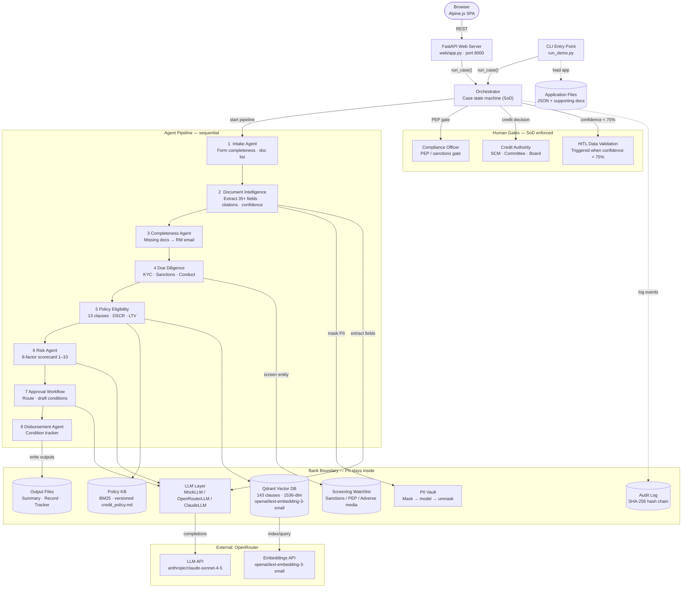

# Architecture — Agentic Loan Lifecycle Management

> Application intake through disbursement conditions · Updated October 2026

## Component diagram



## Layers

| Layer | Components | Responsibility |
|---|---|---|
| **Entry** | Web UI (Alpine.js) + FastAPI, CLI `run_demo.py` | Submit cases, view Case Report, edit Policy Library, run evals |
| **Orchestration** | Orchestrator | Sequence agents, enforce SoD, route human gates, trigger HITL on low confidence |
| **Agent Pipeline** | 8 agents (Intake → Disbursement) | Sequential domain analysis; each agent enriches the shared CaseFile |
| **Human Gates** | Data Validation (Senior Analyst), Compliance Officer, Credit Authority | Up to 3 sequential gates; each enforces role, authority, and SoD in code |
| **LLM Layer** | MockLLM / OpenRouterLLM / ClaudeLLM | Field extraction, narrative drafting — no deterministic decisions |
| **Knowledge (RAG)** | HybridPolicyKB — BM25 (40%) + Qdrant vector (60%) | Clause retrieval; hybrid search returns clause ID, text, source line |
| **Data & Controls** | PII Vault, Screening Watchlist, Audit Log | Tokenise PII, sanctions/PEP screening, tamper-evident log |
| **Outputs** | `decision_summary.md`, `decision_record.json`, `conditions_tracker.json`, `extracted_fields.json` | Auditable artefacts written once the case resolves |

## Authority limits (deterministic routing)

| Facility size | Required approver |
|---|---|
| ≤ USD 2,000,000 | Senior Credit Manager (SCM) |
| ≤ USD 10,000,000 | Regional Credit Committee |
| > USD 10,000,000 | Board Credit Committee |

## RAG — Hybrid search detail

```
Query (e.g. "minimum DSCR for term loans")
         │
         ├──► BM25 keyword match (40%) — PolicyKnowledgeBase
         │         └─ returns top-k clauses by TF-IDF score
         │
         └──► Vector cosine (60%) — Qdrant
                   ├─ embed query: OpenRouter → openai/text-embedding-3-small
                   └─ ANN search in collection policy_{sha256[:16]}
                             └─ 143 points, 1536-dim

Hybrid merge: score = 0.4 × bm25_rank + 0.6 × cosine_sim
Result: clause_id, title, text, source_file, line_number
```

**Re-index trigger**: edit any `.md` file in `data/policy/docs/` → SHA-256 of all policy files changes → new Qdrant collection name computed → `_try_init()` auto-builds new index on next server start. Old collection remains as immutable snapshot.

## HITL confidence gate

```
Document Intelligence Agent
    │
    ├─ avg_extraction_confidence ≥ 0.75 → continue to Due Diligence
    │
    └─ avg_extraction_confidence < 0.75 → data_validation HITL gate (before compliance / credit gates)
              │  Required role: Senior Analyst
              │
              ├─ PROCEED
              │       └─ Pipeline resumes → Due Diligence → Policy → Risk → Credit gate
              │
              └─ RETURN FOR RESUBMISSION
                      └─ Pipeline terminates immediately → final_status = "RETURNED TO RM"
                         (credit gate does NOT fire)
```

`avg_extraction_confidence` is written to `CaseFile.checklist`, `decision_record.json`, and `pending_record.json` by every run.

## Controls summary

- **PII Vault** — every identifier tokenised before any text reaches the LLM; unmasked only in final outputs.
- **Audit log** — SHA-256 hash-chained JSONL; `--verify` flag replays the chain to detect tampering.
- **Prompt pinning** — `PROMPT_VERSION` constant in `llm.py`; version recorded in every `decision_record.json`.
- **Deterministic ratios** — DSCR, LTV, debt/EBITDA, current ratio computed in Python, not inferred by the model.
- **SoD enforcement** — blocked attempts (wrong role, insufficient authority) counted and reported in the summary. Three gate roles enforced: Senior Analyst (data_validation), Compliance Officer (compliance), Credit Authority by tier (credit).
- **Injection quarantine** — borrower documents treated as untrusted data; injection attempts quarantined before model call.
- **Credential isolation** — API keys in `.env.local` (never committed); app reads shell env → `.env.local` → `.env` in priority order.
- **KB caching** — `HybridPolicyKB` built once at server startup and reused across pipeline runs; re-indexed only when policy SHA-256 changes.

## Web server — API endpoints

| Method | Path | Description |
|---|---|---|
| `GET` | `/` | Serve `index.html` (Alpine.js SPA) |
| `GET` | `/api/overview` | System status (RAG, LLM provider, key set) |
| `GET` | `/api/applications` | List all cases (sample + 39 golden) |
| `GET` | `/api/applications/{id}` | Application JSON + numbered document lines + ground truth |
| `POST` | `/api/run/{id}` | Start pipeline in background thread |
| `GET` | `/api/stream/{sid}` | SSE stream of pipeline events |
| `POST` | `/api/approve/{sid}` | Submit human decision at any gate (data_validation / compliance / credit) |
| `GET` | `/api/session/{id}` | Current session status for an application |
| `GET` | `/api/results/{id}` | `decision_record.json` after completion (+ ground-truth comparison) |
| `GET` | `/api/audit/{id}` | Parsed `audit_log.jsonl` |
| `GET` | `/api/audit/{id}/verified` | Same with SHA-256 hash-chain verification |
| `GET` | `/api/pending-approvals` | Active sessions awaiting human decision at any gate |
| `GET` | `/api/evals` | All saved eval run summaries |
| `POST` | `/api/evals/run` | Run 39-case golden-set eval in background |
| `GET` | `/api/evals/status` | Progress and log of background eval run |
| `GET` | `/api/evals/report` | `evals/results/REPORT.md` |
| `POST` | `/api/demos/{name}` | Red-team, policy-change, tamper, replay demos |
| `GET` | `/api/rag/status` | RAG layer status (vector_ready, collection, clause count) |
| `GET` | `/api/policy/docs` | List all policy documents with metadata |
| `GET` | `/api/policy/docs/{name}` | Fetch markdown content of a policy document |
| `PUT` | `/api/policy/docs/{name}` | Save updated policy markdown (triggers RAG re-index on next start) |
