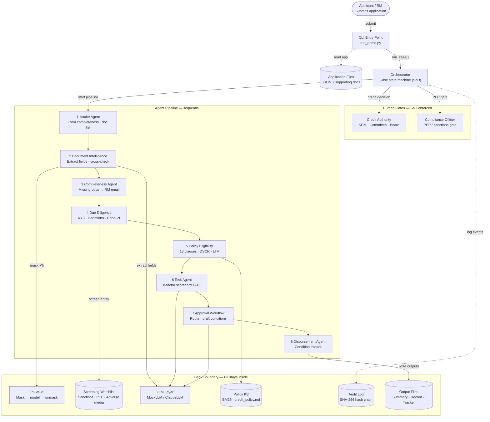

# Architecture — Agentic Loan Lifecycle Management

> Application intake through disbursement conditions

## Component diagram

## Layers

| Layer | Components | Responsibility |
|---|---|---|
| **Entry** | CLI `run_demo.py` | Load case files, invoke orchestrator, stream output |
| **Orchestration** | Orchestrator | Sequence agents, enforce SoD, route human gates |
| **Agent Pipeline** | 8 agents (Intake → Disbursement) | Sequential domain analysis; each agent enriches the shared CaseFile |
| **Human Gates** | Credit Authority, Compliance Officer | Final decisions with delegated authority; overrides require rationale |
| **LLM Layer** | MockLLM / ClaudeLLM (`claude-sonnet-4-6`) | Field extraction, narrative drafting — no deterministic decisions |
| **Data & Controls** | PII Vault, Policy KB, Screening Watchlist, Audit Log | Tokenise PII before model calls, BM25 clause retrieval, sanctions/PEP screening, tamper-evident log |
| **Outputs** | `decision_summary.md`, `decision_record.json`, `conditions_tracker.json`, `extracted_fields.json` | Auditable artefacts written once the case resolves |

## Authority limits (deterministic routing)

| Facility size | Required approver |
|---|---|
| ≤ USD 2 000 000 | Senior Credit Manager (SCM) |
| ≤ USD 10 000 000 | Regional Credit Committee |
| > USD 10 000 000 | Board Credit Committee |

## Controls summary

- **PII Vault** — every identifier is tokenised before any text reaches the LLM; unmasked only in final outputs.
- **Audit log** — SHA-256 hash-chained JSONL; `--verify` flag replays the chain to detect tampering.
- **Prompt pinning** — `PROMPT_VERSION` constant in `llm.py`; version recorded in every `decision_record.json`.
- **Deterministic ratios** — DSCR, LTV, debt/EBITDA, current ratio are computed in Python, not inferred by the model.
- **SoD enforcement** — blocked attempts (wrong role, insufficient authority) are counted and reported in the summary.
