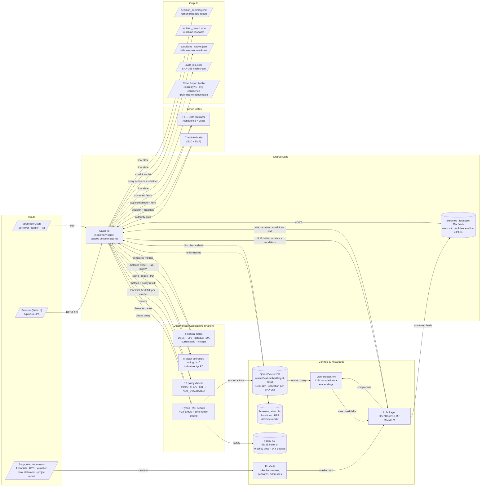

# Data Flow — Agentic Loan Lifecycle

How data enters, transforms, and exits the system. Updated October 2026.

## Flow diagram



## Field extraction detail

| Document type | Key extracted fields |
|---|---|
| `audited_financials` | revenue, EBITDA, total debt, current assets/liabilities, net profit |
| `bank_statement_summary` | average balance, returned items, bank credits, credit-to-revenue ratio |
| `collateral_valuation` | property value, valuation date, valuation age (days), LTV |
| `project_report` | projected revenue, projected DSCR, promoter contribution % |
| `kyc_ubo_declaration` | director names, date of incorporation, ownership structure |
| `board_resolution` | authorised signatories, resolution date |
| `application.json` | borrower legal name, sector, country, facility type, amount, tenor, purpose |

Every extracted field is stored as `{value, source_doc, page, line_ref, confidence}` and written to `extracted_fields.json`.

Confidence scoring:
- **≥ 90%** — citation verified, value present on the cited line
- **75–89%** — value extracted but citation is approximate
- **< 75%** — low-confidence; triggers HITL data validation gate

## RAG search pipeline

```
Analyst submits a question (or agent queries a policy rule)
         │
         ├── BM25 keyword match (40% weight)
         │       └── PolicyKnowledgeBase._search_bm25()
         │               └── TF-IDF over 143 clauses from 9 policy docs
         │
         └── Vector cosine similarity (60% weight)
                 ├── Embed query: POST /v1/embeddings to OpenRouter
                 │       model: openai/text-embedding-3-small → 1536-dim vector
                 └── ANN search in Qdrant collection policy_{sha256[:16]}
                         └── Returns top-k by cosine similarity

Merge: score = 0.4 × normalised_bm25 + 0.6 × cosine_sim
Output: clause_id, title, text, source_file, line_number, hybrid_score
```

Re-index trigger: any edit to `data/policy/docs/*.md` → SHA-256 of all files changes → new collection name → auto-built on next server start.

## PII handling

```
Raw document text
       ↓
  PII Vault.mask()           ← replaces names, accounts, addresses with tokens T-0001, T-0002 …
       ↓
  LLM call (masked text)     ← model never sees real PII
       ↓
  PII Vault.unmask()         ← tokens replaced back before storing in CaseFile
       ↓
  extracted_fields.json      ← real values; never logged to external services
```

## Audit chain

Each agent action appends one JSONL line:

```json
{"seq": 42, "ts": "2026-10-17T14:23:01Z", "actor": "system", "action": "policy_check_complete",
 "app_id": "APP-2026-0201", "detail": {"clauses_evaluated": 13, "fail_count": 0},
 "prev_hash": "a3f9…", "hash": "7c1d…"}
```

`hash = SHA-256(seq + ts + actor + action + detail + prev_hash)` — any tampering breaks the chain.

Verify with: `python run_demo.py --verify output/<APP-ID>/audit_log.jsonl`

## Case Report data assembly (web)

```
CaseFile (final state)
    │
    ├── Reliability score: verified_fields / total_fields × 100
    │       Source: extracted_fields where citation_verified = true
    │
    ├── Avg confidence: mean(field.confidence for all fields)
    │
    ├── Decision pipeline: sequential steps from CaseFile.timeline
    │       └── Includes HITL step if triggered (with approver name + rationale)
    │
    ├── Key metrics: DSCR, LTV, Debt/EBITDA, Current Ratio, Vintage, Bank/Revenue
    │       Colour-coded vs. policy thresholds (green/amber/red)
    │
    ├── Grounded evidence: grouped by document
    │       Each row: field name · value · source:line · quote · confidence %
    │
    └── Policy flags: FLAG/FAIL clauses only
            Each: clause ID · title · actual vs. required · curable note · conditions
```

## Output artefacts

| File | Format | Consumer |
|---|---|---|
| `decision_summary.md` | Markdown | Credit file, regulator, audit committee |
| `decision_record.json` | JSON | Downstream LOS, data warehouse, reporting |
| `extracted_fields.json` | JSON | QA review, model risk validation |
| `conditions_tracker.json` | JSON | Operations / disbursement team |
| `audit_log.jsonl` | JSONL (hash-chained) | Compliance, internal audit, forensics |
| `rm_request.txt` | Plain text | Relationship manager (missing-docs request) |
| Case Report (web) | Alpine.js rendered | Credit analyst, reviewer, demo audience |
