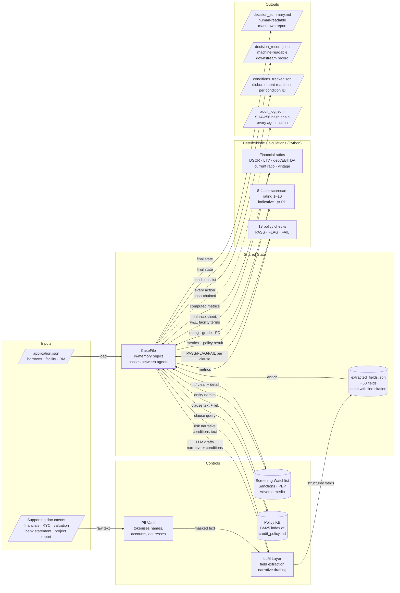

# Data Flow — Agentic Loan Lifecycle

How data enters, transforms, and exits the system.

## Flow diagram



## Field extraction detail

| Document type | Key extracted fields |
|---|---|
| `financials` | revenue, EBITDA, total debt, current assets/liabilities, net profit |
| `bank_statement` | average balance, returned items, bank credits, credit-to-revenue ratio |
| `valuation` | property value, valuation date, valuation age (days), LTV |
| `project_report` | projected revenue, projected DSCR, promoter contribution % |
| `kyc` | director names, date of incorporation, ownership structure |
| `application.json` | borrower legal name, sector, country, facility type, amount, tenor, purpose |

Every extracted field is stored as `{value, source_doc, page, line_ref, confidence}` and written to `extracted_fields.json`.

## PII handling

```
Raw document text
       ↓
  PII Vault.mask()           ← replaces names, accounts, addresses with tokens  T-0001, T-0002 …
       ↓
  LLM call (masked text)     ← model never sees real PII
       ↓
  PII Vault.unmask()         ← tokens replaced back before storing in CaseFile
       ↓
  extracted_fields.json      ← real values, never logged to external services
```

## Audit chain

Each agent action appends one JSONL line:

```json
{"seq": 42, "ts": "2026-10-17T14:23:01Z", "actor": "system", "action": "policy_check_complete",
 "app_id": "APP-2026-0001", "detail": {"clauses_evaluated": 13, "fail_count": 0},
 "prev_hash": "a3f9…", "hash": "7c1d…"}
```

`hash = SHA-256(seq + ts + actor + action + detail + prev_hash)` — any tampering breaks the chain.
Verify with: `python run_demo.py --verify output/<APP-ID>/audit_log.jsonl`

## Output artefacts

| File | Format | Consumer |
|---|---|---|
| `decision_summary.md` | Markdown | Credit file, regulator, audit committee |
| `decision_record.json` | JSON | Downstream LOS, data warehouse, reporting |
| `extracted_fields.json` | JSON | QA review, model risk validation |
| `conditions_tracker.json` | JSON | Operations / disbursement team |
| `audit_log.jsonl` | JSONL (hash-chained) | Compliance, internal audit, forensics |
| `rm_request.txt` | Plain text | Relationship manager (missing-docs request) |
