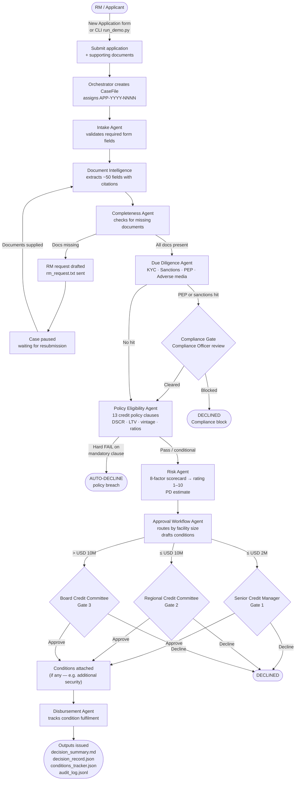

# User Flow — Loan Lifecycle Portal

End-to-end journey from application submission to decision issuance.

## Flow diagram

## Stage descriptions

| Stage | Actor | What happens |
|---|---|---|
| **Submit** | RM / Applicant | Application JSON + docs uploaded via web portal or placed in `data/applications/APP-*/` for CLI |
| **Intake** | IntakeAgent | Checks that all required fields are present; lists expected document types |
| **Doc extraction** | DocumentIntelligenceAgent | Calls LLM (PII masked) to extract structured fields from each document with line citations |
| **Completeness** | CompletenessAgent | Flags missing or expired documents; drafts an RM request if blocking |
| **Due diligence** | DueDiligenceAgent | Screens borrower name and directors against sanctions, PEP, and adverse media watchlists |
| **Compliance gate** | Compliance Officer | Manual clearance required if a watchlist hit is found; blocked if officer lacks authority |
| **Policy** | PolicyEligibilityAgent | Evaluates 13 clauses from `credit_policy.md` (BM25 retrieval); hard fails trigger auto-decline |
| **Risk scoring** | RiskAgent | Scores 8 factors (leverage, DSCR, LTV, conduct, etc.) → composite 1–10 rating + PD estimate |
| **Approval workflow** | ApprovalWorkflowAgent | Routes to the correct authority tier; drafts conditions; ensures SoD (same person cannot approve twice) |
| **Human decision** | SCM / Committee / Board | Approve, decline, or override (requires rationale); blocked if wrong role |
| **Disbursement** | DisbursementAgent | Writes final outputs; tracks condition status per condition ID |

## Key portal interactions

| Interaction | Entry point |
|---|---|
| Submit new application | "New Application" button → 3-step wizard (Borrower → Facility → Documents) |
| Run a pre-loaded demo | "Run" button on case card in sidebar |
| Review streamed output | Auto-scrolling log panel, live gate prompts appear inline |
| Approve / Decline at a gate | Inline approval panel with role selector, rationale field, override toggle |
| View decision summary | "Decision" tab → `decision_summary.md` rendered as markdown |
| Download artefacts | "Files" tab → `decision_record.json`, `extracted_fields.json`, `audit_log.jsonl` |
| Verify audit chain | `python run_demo.py --verify output/<APP-ID>/audit_log.jsonl` |
